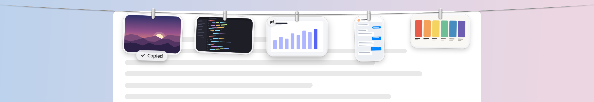

<picture>
  <source media="(prefers-color-scheme: dark)" srcset="docs/images/line-dark.png">
  
</picture>

<h3 align="center">Clipline</h3>

<p align="center">
  Your screenshots, on a line at the top of the screen.
  <br>
  For Windows 10 and 11. Free and open source.
  <br><br>
  English&nbsp;·&nbsp;<a href="docs/README.zh-Hant.md">繁體中文</a>
</p>

<br>

## Out of sight. Within reach.

Every screenshot you take hangs on a line just above your work.
Rest the pointer at the top edge of the screen and it glides down.
Move away and it's gone.

Take one with <kbd>Win</kbd>&thinsp;<kbd>Shift</kbd>&thinsp;<kbd>S</kbd> and it lifts off
from where you took it and flies up to the line.

<br>

## A gesture for everything.

| | |
|:--|:--|
| Click | Copy the image. |
| Press and hold | Mark it up in Paint. Save, and the line shows the new version. |
| Double click | Open it in its usual app. |
| Middle click | Take a quick look. The arrow keys move along the line. |
| Drag into an app | Send a copy. It stays on the line. |
| Drag into a folder | Keep it there. It leaves the line. |
| Drag to the Recycle Bin, or click the corner | Let it go. |
| Right click | Show in File Explorer, Save to Desktop, take down everything to one side. |
| Rest the pointer at the top edge | Bring the line down on that screen. |
| Click anything at the top edge | Put it away. |
| <kbd>Ctrl</kbd>&thinsp;<kbd>Alt</kbd>&thinsp;<kbd>T</kbd> | Show or hide the line. Change it under Shortcut in the tray menu. |
| Mouse wheel | Move along a long line, with Keep on line set to 25, 50 or 100. |

The corner shows what it will do: an **×** sends a file to the Recycle Bin,
an **eye** only takes it off the line and leaves the file where it is.

<br>

## Where the pictures come from.

Clipline never takes screenshots itself. It watches the folders Windows
already saves to, and picks up each new file the moment it is written:

| Folder | What lands there |
|:--|:--|
| Pictures\Screenshots | <kbd>Win</kbd>&thinsp;<kbd>Print Screen</kbd>, and Snipping Tool captures when *Automatically save screenshots* is on (the default). |
| Videos\Screen Recordings | Snipping Tool recordings. They hang with a play button. |
| Videos\Captures | Xbox Game Bar captures. |

Add up to three folders of your own under **Watch folders**, like the one
another capture app saves to. Files already there are left alone; only new
ones hang.

**Hang copied images** (off until you turn it on) also hangs pictures copied
to the clipboard. Only pictures: anything copied along with text or a file,
and anything an app marks as private, like a password manager, is left alone.
A capture that arrives both ways hangs once.

<br>

## Your Screenshots folder. Finally tidy.

Turn on **Send discarded screenshots to the Recycle Bin**, and letting a
photo go also sends its file to the Recycle Bin. The folder only keeps what
you drag out to keep. It's off by default; nothing is ever deleted outright.

<br>

## Private by design.

No account. No network. No analytics.
Clipline runs entirely on your PC, and your screenshots never leave it.

To know where a snip was taken, Clipline remembers the corners of the last few
rectangles dragged with the mouse, in memory, for a few seconds. Nothing about
what was clicked, and nothing from the keyboard.

<br>

## In the tray

Everything else lives in the tray icon's menu, the way Tendedero lives in the
Mac's menu bar: when the line comes down, how many photos it keeps, its size,
the shortcut, sounds and starting with Windows. Click the icon to show or hide
the line. The photo in the icon fills in while copied images are being hung.

Clipline stays out of full screen apps, a video or a game, unless you turn on
**Over full screen apps**.

<br>

## Install

Download a zip from the latest release, unzip it anywhere and open
`Clipline.exe`. There is no installer: it changes no system settings, and
**Start with Windows** is a per-user entry you can turn off from the tray.
To remove it, quit from the tray and delete the folder; your line and
settings are in `%LOCALAPPDATA%\Clipline`.

| Download | |
|:--|:--|
| `Clipline-win-x64.zip` | Runs on any 64-bit Windows 10 or 11. .NET is inside. |
| `Clipline-win-arm64.zip` | The same, for Arm PCs. |
| `Clipline-win-x64-small.zip` | Under a megabyte. Needs the [.NET 10 Desktop Runtime](https://dotnet.microsoft.com/download/dotnet/10.0). |

The app is not code-signed yet, so Windows SmartScreen asks once before it opens.

<br>

## Build from source

Requires the [.NET 10 SDK](https://dotnet.microsoft.com/download/dotnet/10.0).

```powershell
git clone https://github.com/xxxJay123/Clipline.git
cd Clipline
./scripts/build.ps1                       # build and run the tests
dotnet run --project src/Clipline -- --demo   # a line of made-up screenshots
./scripts/publish.ps1 -Runtime win-x64    # artifacts/Clipline-win-x64.zip
```

`--demo` uses its own folder in `%TEMP%` and never touches your screenshots.
`./scripts/snapshot.ps1` redraws the pictures in this README without touching
the screen.

<details>
<summary>Inside the app</summary>
<br>

| File | Role |
|:--|:--|
| `AppController.cs` | Tray, shortcut, watchers, and when the line comes down and goes back up |
| `LineWindow.cs` | The transparent strip along the top of the screen |
| `LineSurface.cs` | The rope, the hint, and the frame loop that moves everything |
| `CardView.cs` | One photo: glass frame, clip, swing, breeze, and its gestures |
| `Overlay.cs` | A capture flying up to the line, and a photo falling off it |
| `Line.cs` | What is hanging, and what you can do with it |
| `Watchers.cs` | New files in the capture folders, the clipboard, snips, full screen apps |
| `DragOut.cs` | Dragging a photo out as a real file |
| `PreviewWindow.cs` | The quick look |
| `SystemHooks.cs` | The hidden window, the shortcut, the tray icon and native menus |
| `Clipline.Core` | Layout, springs, settings, capture matching, strings: no Windows, all tested |

Every picture here, the icon included, is drawn in code by `tools/IconMaker`
and `src/Clipline/Samples.cs`. Translations live in
`src/Clipline.Core/Strings.cs`; the tests check that none is missing.

</details>

<br>

---

<sub>
Clipline is a Windows take on <a href="https://github.com/alejandrobujan/tendedero">Tendedero</a>
by Alejandro Buján, and ports its design and much of its behaviour. It does not use
Tendedero's name or icon. See <a href="NOTICE.md">NOTICE.md</a>. MIT licensed.
</sub>
